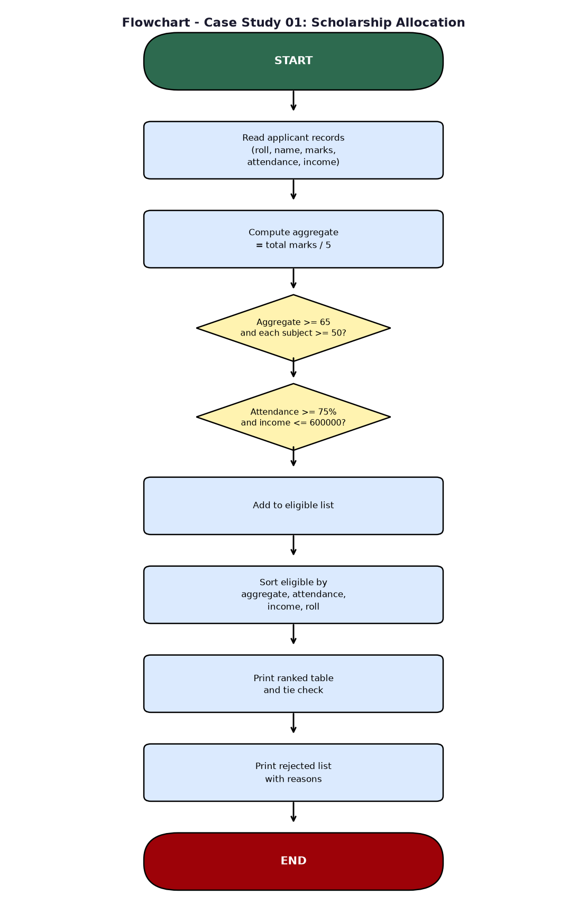
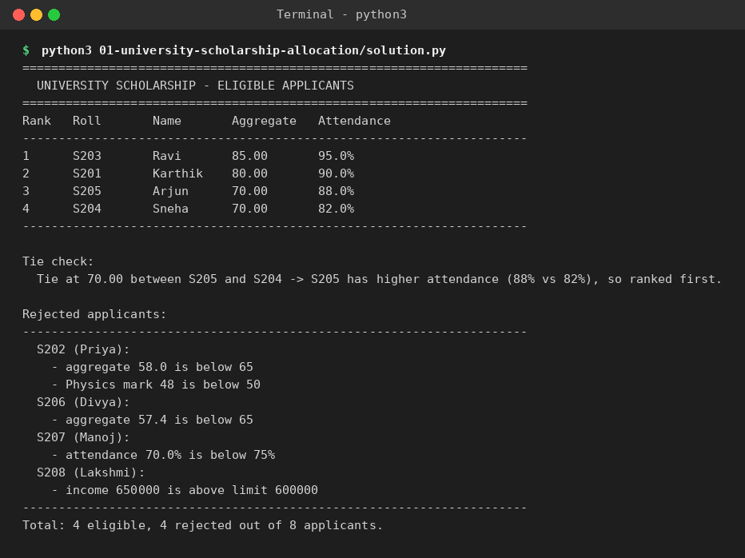

# Case Study 01 — University Scholarship Allocation

**Name:** BOPPUDI KARTHIK  
**Roll No:** 26000451  
**Case Study No. in assignment:** 1

## Problem statement

Design a system that evaluates scholarship applicants using aggregate marks, subject-wise minimum scores, attendance and family income. The system should rank the eligible students and resolve ties using predefined rules, and it should also show why each rejected student was rejected.

## Objectives

To store applicant records using tuples and lists, to check four eligibility conditions using if-else statements, to calculate aggregate using loops and operators, to sort eligible students with a tie-breaking rule, and to print every rejection reason clearly.

## Assumptions

Each applicant has 5 subject marks out of 100 (Maths, Physics, Chemistry, English, CS). Aggregate is the average of the 5 marks. Cutoffs are: aggregate 65 or more, each subject 50 or more, attendance 75% or more, family income Rs 6,00,000 or less. If two students have the same aggregate, higher attendance comes first, then lower income, then smaller roll number. All data is sample data.

## Algorithm

```
1. START
2. Set MIN_AGGREGATE = 65, MIN_SUBJECT = 50, MIN_ATTENDANCE = 75, MAX_INCOME = 600000
3. Create empty lists eligible_list and rejected_list
4. For each applicant in APPLICANTS:
   - Unpack the tuple into roll, name, marks, attendance, income
   - Calculate aggregate = sum of marks / 5 using a loop
   - Create empty reasons list
   - If aggregate < 65, add reason
   - For each subject, if mark < 50, add reason with subject name
   - If attendance < 75, add reason
   - If income > 600000, add reason
   - If reasons is empty, add to eligible_list, else add to rejected_list
5. Sort eligible_list by (-aggregate, -attendance, income, roll)
6. Print ranked table with rank 1 to n
7. Check adjacent rows: if aggregates are equal, print tie message
8. Print rejected applicants with all reasons
9. Print total counts
10. END
```

## Flowchart



## Pseudocode

```
BEGIN SCHOLARSHIP_ALLOCATION
    MIN_AGGREGATE <- 65
    MIN_SUBJECT <- 50
    MIN_ATTEND <- 75
    MAX_INCOME <- 600000
    eligible <- []
    rejected <- []

    FOR each applicant IN APPLICANTS DO
        (roll, name, marks, attendance, income) <- applicant
        total <- 0
        FOR m IN marks DO total <- total + m
        aggregate <- total / 5
        reasons <- []

        IF aggregate < MIN_AGGREGATE THEN add reason
        FOR i <- 0 TO 4 DO
            IF marks[i] < MIN_SUBJECT THEN add reason
        IF attendance < MIN_ATTEND THEN add reason
        IF income > MAX_INCOME THEN add reason

        IF reasons is empty THEN
            APPEND (roll, name, aggregate, attendance, income) TO eligible
        ELSE
            APPEND (roll, name, reasons) TO rejected
    END FOR

    SORT eligible BY aggregate desc, attendance desc, income asc, roll asc
    PRINT ranked table
    FOR i <- 0 TO len(eligible)-2 DO
        IF eligible[i].aggregate = eligible[i+1].aggregate THEN PRINT tie message
    PRINT rejected list with reasons
    PRINT summary
END
```

## Python source code

```python
# Case Study 01: University Scholarship Allocation
# Name: BOPPUDI KARTHIK, Roll No: 26000451
# Uses: variables, data types, operators, if-else, loops, lists, tuples, unpacking

MIN_AGGREGATE = 65.0
MIN_SUBJECT = 50
MIN_ATTENDANCE = 75.0
MAX_INCOME = 600000
SUBJECTS = ["Maths", "Physics", "Chemistry", "English", "CS"]

# each record is a tuple: (roll, name, marks list, attendance %, income)
APPLICANTS = [
    ("S201", "Karthik", [78, 82, 75, 80, 85], 90, 350000),
    ("S202", "Priya", [62, 48, 65, 60, 55], 80, 400000),
    ("S203", "Ravi", [85, 80, 88, 82, 90], 95, 280000),
    ("S204", "Sneha", [70, 68, 72, 66, 74], 82, 420000),
    ("S205", "Arjun", [70, 68, 72, 66, 74], 88, 390000),
    ("S206", "Divya", [55, 60, 52, 58, 62], 80, 300000),
    ("S207", "Manoj", [75, 70, 78, 72, 80], 70, 320000),
    ("S208", "Lakshmi", [80, 76, 84, 78, 82], 92, 650000),
]


def check_applicant(applicant):
    # unpack the tuple
    roll, name, marks, attendance, income = applicant
    total = 0
    for m in marks:
        total = total + m
    aggregate = total / len(marks)
    reasons = []

    if aggregate < MIN_AGGREGATE:
        reasons.append("aggregate %.1f is below %.0f" % (aggregate, MIN_AGGREGATE))

    # check each subject minimum
    for i in range(len(marks)):
        if marks[i] < MIN_SUBJECT:
            reasons.append("%s mark %d is below %d" % (SUBJECTS[i], marks[i], MIN_SUBJECT))

    if attendance < MIN_ATTENDANCE:
        reasons.append("attendance %.1f%% is below %.0f%%" % (attendance, MIN_ATTENDANCE))

    if income > MAX_INCOME:
        reasons.append("income %d is above limit %d" % (income, MAX_INCOME))

    eligible = len(reasons) == 0
    return eligible, aggregate, reasons


def rank_key(record):
    # sort by aggregate high to low, then attendance high to low,
    # then income low to high, then roll number
    roll, name, aggregate, attendance, income = record
    return (-aggregate, -attendance, income, roll)


def main():
    eligible_list = []
    rejected_list = []

    for applicant in APPLICANTS:
        ok, aggregate, reasons = check_applicant(applicant)
        roll, name, marks, attendance, income = applicant
        if ok:
            eligible_list.append((roll, name, round(aggregate, 2), attendance, income))
        else:
            rejected_list.append((roll, name, reasons))

    eligible_list.sort(key=rank_key)

    print("=" * 70)
    print("  UNIVERSITY SCHOLARSHIP - ELIGIBLE APPLICANTS")
    print("=" * 70)
    print("%-6s %-10s %-10s %-11s %-10s" % ("Rank", "Roll", "Name", "Aggregate", "Attendance"))
    print("-" * 70)
    for i in range(len(eligible_list)):
        roll, name, aggregate, attendance, income = eligible_list[i]
        print("%-6d %-10s %-10s %-11.2f %-10s" % (i + 1, roll, name, aggregate, "%.1f%%" % attendance))
    print("-" * 70)

    # check for ties in aggregate
    print("\nTie check:")
    tie_found = False
    for i in range(len(eligible_list) - 1):
        if eligible_list[i][2] == eligible_list[i + 1][2]:
            tie_found = True
            a = eligible_list[i]
            b = eligible_list[i + 1]
            print("  Tie at %.2f between %s and %s -> %s has higher attendance (%.0f%% vs %.0f%%), so ranked first."
                  % (a[2], a[0], b[0], a[0], a[3], b[3]))
    if tie_found == False:
        print("  No ties found.")

    print("\nRejected applicants:")
    print("-" * 70)
    for roll, name, reasons in rejected_list:
        print("  %s (%s):" % (roll, name))
        for r in reasons:
            print("    - %s" % r)
    print("-" * 70)
    print("Total: %d eligible, %d rejected out of %d applicants."
          % (len(eligible_list), len(rejected_list), len(APPLICANTS)))


if __name__ == "__main__":
    main()
```

## Test cases

8 test cases are written in test_cases.py. They check: Karthik eligible with aggregate 80.0; Priya rejected for aggregate 58.0; Priya subject failure for Physics 48; Lakshmi rejected for income; Manoj rejected for attendance 70%; Ravi ranked first; tie at 70.0 between Sneha and Arjun broken by attendance (Arjun 88% first); total 4 eligible and 4 rejected. All tests pass.

## Output screenshot



## Conclusion

The program correctly checks all four conditions for every applicant, ranks the eligible students in the right order, and explains every rejection. The tie at 70.0 was resolved correctly because Arjun has higher attendance than Sneha. Only syllabus topics like tuples, lists, loops, if-else and unpacking were used.
