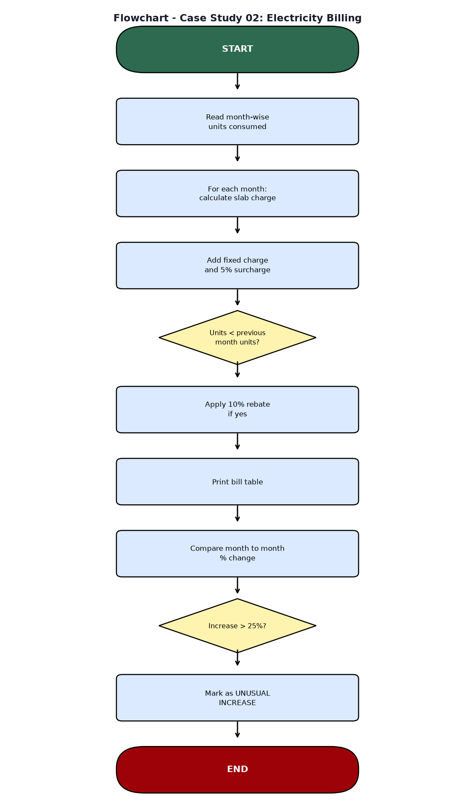
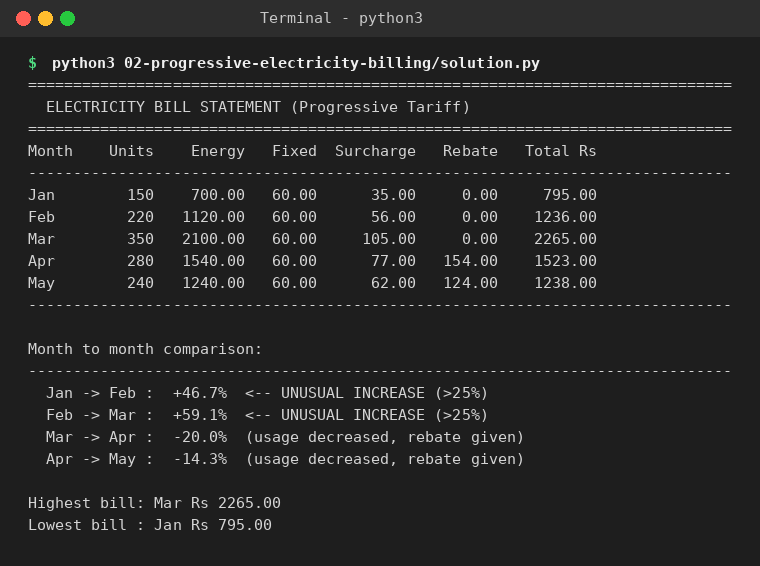

# Case Study 02 — Progressive Electricity Billing

**Name:** BOPPUDI KARTHIK  
**Roll No:** 26000451  
**Case Study No. in assignment:** 2

## Problem statement

Calculate household electricity bills using multiple consumption slabs, fixed charges, surcharges and rebates. Then compare bills across several months and identify unusual increases in consumption.

## Objectives

To calculate slab-wise energy charge using a loop over slab tuples, to add fixed charge and surcharge with operators, to give rebate when usage decreases, and to compare month-to-month percentage change to flag unusual increases.

## Assumptions

Tariff slabs are: 0-100 units at Rs 4, 101-250 at Rs 6, 251-400 at Rs 8, above 400 at Rs 10. Fixed charge is Rs 60 per month. Surcharge is 5% of energy charge. If units fall compared to previous month, 10% rebate is given on energy charge. An increase of more than 25% is treated as unusual. Data for 5 months (Jan to May) is sample data.

## Algorithm

```
1. START
2. Define SLABS as list of (limit, rate) tuples, FIXED_CHARGE = 60, SURCHARGE_RATE = 0.05, REBATE_RATE = 0.10, UNUSUAL_LIMIT = 0.25
3. For each month in MONTHS:
   - Calculate energy charge slab by slab using a loop
   - surcharge = energy * 0.05
   - If previous month exists and units < previous units, rebate = energy * 0.10 else rebate = 0
   - total = energy + fixed + surcharge - rebate
   - Store bill tuple
4. Print bill table for all months
5. For i = 1 to 4, calculate % change = (units[i] - units[i-1]) / units[i-1] * 100
6. If change > 25%, print UNUSUAL INCREASE flag
7. Find highest and lowest bill by looping
8. END
```

## Flowchart



## Pseudocode

```
BEGIN ELECTRICITY_BILLING
    SLABS <- [(100,4), (250,6), (400,8), (10000,10)]
    FIXED <- 60

    FUNCTION energy_charge(units):
        charge <- 0
        prev <- 0
        FOR (limit, rate) IN SLABS DO
            IF units <= prev THEN BREAK
            slab_units <- min(units, limit) - prev
            charge <- charge + slab_units * rate
            prev <- limit
        RETURN charge

    FOR each (month, units) IN MONTHS DO
        energy <- energy_charge(units)
        surcharge <- energy * 0.05
        IF prev_units exists AND units < prev_units THEN
            rebate <- energy * 0.10
        ELSE rebate <- 0
        total <- energy + FIXED + surcharge - rebate
        STORE bill
        prev_units <- units

    PRINT bill table
    FOR i <- 1 TO 4 DO
        change <- (units[i] - units[i-1]) / units[i-1]
        IF change > 0.25 THEN PRINT "UNUSUAL INCREASE"
    PRINT highest and lowest bill
END
```

## Python source code

```python
# Case Study 02: Progressive Electricity Billing
# Name: BOPPUDI KARTHIK, Roll No: 26000451
# Uses: variables, operators, if-else, loops, lists, tuples, unpacking

# slabs as tuples: (upper limit, rate per unit)
SLABS = [(100, 4.0), (250, 6.0), (400, 8.0), (10000, 10.0)]
FIXED_CHARGE = 60.0
SURCHARGE_RATE = 0.05   # 5% surcharge on energy charge
REBATE_RATE = 0.10      # 10% rebate if usage falls from last month
UNUSUAL_LIMIT = 0.25    # more than 25% rise is unusual

# (month, units used)
MONTHS = [
    ("Jan", 150),
    ("Feb", 220),
    ("Mar", 350),
    ("Apr", 280),
    ("May", 240),
]


def energy_charge(units):
    # calculate slab wise charge
    charge = 0.0
    prev_limit = 0
    for limit, rate in SLABS:
        if units <= prev_limit:
            break
        if units > limit:
            slab_units = limit - prev_limit
        else:
            slab_units = units - prev_limit
        charge = charge + slab_units * rate
        prev_limit = limit
    return charge


def calculate_bill(units, prev_units):
    energy = energy_charge(units)
    surcharge = energy * SURCHARGE_RATE
    rebate = 0.0
    if prev_units != None and units < prev_units:
        rebate = energy * REBATE_RATE
    total = energy + FIXED_CHARGE + surcharge - rebate
    # return as tuple: (units, energy, fixed, surcharge, rebate, total)
    return (units, round(energy, 2), FIXED_CHARGE, round(surcharge, 2), round(rebate, 2), round(total, 2))


def main():
    bills = []
    prev = None
    for month, units in MONTHS:
        bill = calculate_bill(units, prev)
        bills.append((month, bill))
        prev = units

    print("=" * 78)
    print("  ELECTRICITY BILL STATEMENT (Progressive Tariff)")
    print("=" * 78)
    print("%-6s %7s %9s %7s %10s %8s %10s" % ("Month", "Units", "Energy", "Fixed", "Surcharge", "Rebate", "Total Rs"))
    print("-" * 78)
    for month, b in bills:
        units, energy, fixed, surcharge, rebate, total = b
        print("%-6s %7d %9.2f %7.2f %10.2f %8.2f %10.2f" % (month, units, energy, fixed, surcharge, rebate, total))
    print("-" * 78)

    print("\nMonth to month comparison:")
    print("-" * 78)
    for i in range(1, len(bills)):
        m1, b1 = bills[i - 1]
        m2, b2 = bills[i]
        change = (b2[0] - b1[0]) / b1[0]
        pct = change * 100
        flag = ""
        if change > UNUSUAL_LIMIT:
            flag = "  <-- UNUSUAL INCREASE (>25%)"
        elif change < 0:
            flag = "  (usage decreased, rebate given)"
        print("  %s -> %s : %+6.1f%%%s" % (m1, m2, pct, flag))

    # find highest and lowest bill
    highest_month = bills[0][0]
    highest_total = bills[0][1][5]
    lowest_month = bills[0][0]
    lowest_total = bills[0][1][5]
    for month, b in bills:
        if b[5] > highest_total:
            highest_total = b[5]
            highest_month = month
        if b[5] < lowest_total:
            lowest_total = b[5]
            lowest_month = month
    print("\nHighest bill: %s Rs %.2f" % (highest_month, highest_total))
    print("Lowest bill : %s Rs %.2f" % (lowest_month, lowest_total))


if __name__ == "__main__":
    main()
```

## Test cases

11 test cases are written in test_cases.py. They check slab charges for 100, 250, 400 and 450 units (400, 1300, 2500, 3000), fixed charge 60, surcharge 5%, rebate on decrease, no rebate on increase, unusual increase detection, total for 100 units = 480, and 5 months data. All tests pass.

## Output screenshot



## Conclusion

Slab calculation works correctly for all ranges. Rebate is applied only when usage decreases, and unusual increases above 25% are flagged correctly (Jan to Feb and Feb to Mar in the sample). The program uses only loops, if-else, lists, tuples and operators from the syllabus.
