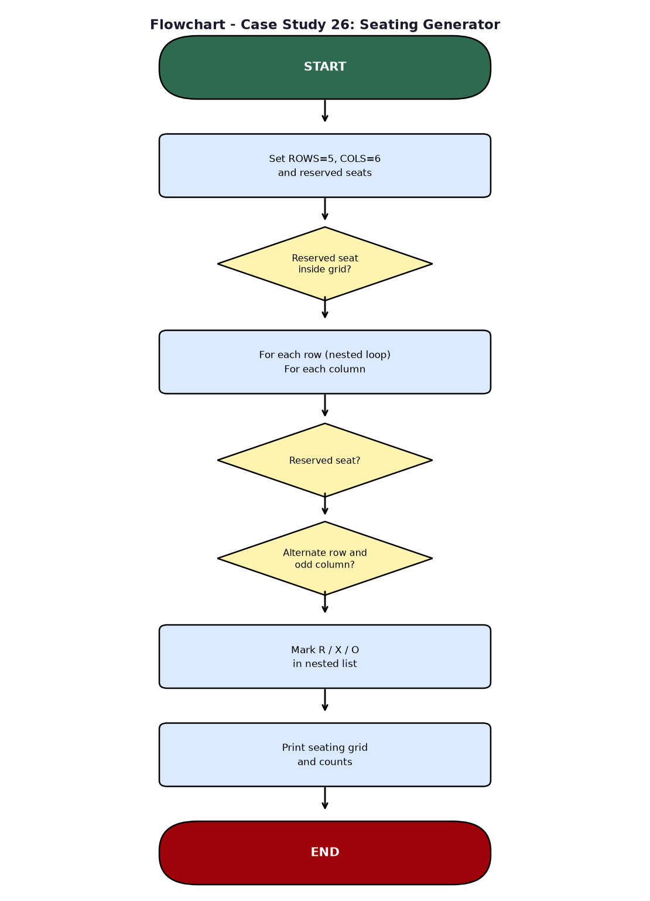
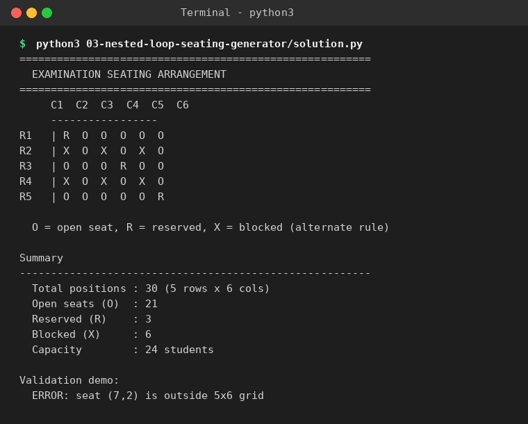

# Case Study 03 — Nested Loop Examination Seating Generator

**Name:** BOPPUDI KARTHIK  
**Roll No:** 26000451  
**Case Study No. in assignment:** 26

## Problem statement

Generate a seating arrangement for an examination hall with row and column identifiers, reserved positions, alternate seating restrictions and a fixed classroom capacity. Validate that reserved seats are inside the grid.

## Objectives

To build a nested list grid using nested loops, to mark reserved, blocked and open seats with if-else conditions, to validate reserved seat positions, and to count seats by looping over the nested list.

## Assumptions

Classroom has 5 rows and 6 columns (30 positions). Reserved seats are (1,1), (3,4) and (5,6) using 1-based row and column numbers. In rows 2 and 4, odd columns (1, 3, 5) are blocked for alternate spacing. O means open, R means reserved, X means blocked. Capacity is open + reserved seats.

## Algorithm

```
1. START
2. Set ROWS = 5, COLS = 6, RESERVED = [(1,1), (3,4), (5,6)], ALT_ROWS = (2,4), ALT_BLOCKED = (1,3,5)
3. Check each reserved seat: if row or column is outside 1..ROWS / 1..COLS, print error
4. Create empty nested list seat
5. For r = 1 to ROWS (outer loop):
   - Create empty row list
   - For c = 1 to COLS (inner loop):
     - If (r,c) in RESERVED, append "R"
     - Else if r in ALT_ROWS and c in ALT_BLOCKED, append "X"
     - Else append "O"
   - Append row to seat
6. Print grid with column headers C1..C6 and row labels R1..R5
7. Count O, R, X by looping over nested list
8. Print summary and capacity
9. Demo validation with seat (7,2) which is outside the grid
10. END
```

## Flowchart



## Pseudocode

```
BEGIN SEATING_GENERATOR
    ROWS <- 5, COLS <- 6
    RESERVED <- [(1,1), (3,4), (5,6)]

    FOR (r,c) IN RESERVED DO
        IF r < 1 OR r > ROWS OR c < 1 OR c > COLS THEN PRINT error

    seat <- []
    FOR r <- 1 TO ROWS DO
        row <- []
        FOR c <- 1 TO COLS DO
            IF (r,c) IN RESERVED THEN APPEND "R" TO row
            ELSE IF r IN (2,4) AND c IN (1,3,5) THEN APPEND "X" TO row
            ELSE APPEND "O" TO row
        APPEND row TO seat

    PRINT grid
    COUNT O, R, X by looping over seat
    PRINT summary
END
```

## Python source code

```python
# Case Study 26: Nested Loop Examination Seating Generator
# Name: BOPPUDI KARTHIK, Roll No: 26000451
# Uses: nested loops, if-else, lists (nested list), operators

ROWS = 5
COLS = 6
# reserved seats as tuples (row, col), 1-based
RESERVED = [(1, 1), (3, 4), (5, 6)]
# in these rows only even columns are allowed (alternate seating)
ALT_ROWS = (2, 4)
ALT_BLOCKED = (1, 3, 5)


def check_reserved():
    problems = []
    for r, c in RESERVED:
        if r < 1 or r > ROWS or c < 1 or c > COLS:
            problems.append("seat (%d,%d) is outside the %dx%d grid" % (r, c, ROWS, COLS))
    return problems


def build_seating():
    # nested list: O = open, R = reserved, X = blocked
    seat = []
    for r in range(1, ROWS + 1):
        row = []
        for c in range(1, COLS + 1):
            if (r, c) in RESERVED:
                row.append("R")
            elif r in ALT_ROWS and c in ALT_BLOCKED:
                row.append("X")
            else:
                row.append("O")
        seat.append(row)
    return seat


def print_seating(seat):
    print("     " + "  ".join("C%d" % c for c in range(1, COLS + 1)))
    print("     " + "-" * (COLS * 3 - 1))
    for r in range(ROWS):
        cells = "  ".join(seat[r][c] for c in range(COLS))
        print("R%-3d | %s" % (r + 1, cells))
    print("\n  O = open seat, R = reserved, X = blocked (alternate rule)")


def count_seats(seat):
    open_count = 0
    reserved_count = 0
    blocked_count = 0
    for row in seat:
        for cell in row:
            if cell == "O":
                open_count = open_count + 1
            elif cell == "R":
                reserved_count = reserved_count + 1
            else:
                blocked_count = blocked_count + 1
    return open_count, reserved_count, blocked_count


def main():
    print("=" * 56)
    print("  EXAMINATION SEATING ARRANGEMENT")
    print("=" * 56)

    problems = check_reserved()
    if len(problems) > 0:
        print("Validation errors found:")
        for p in problems:
            print("  - " + p)
        return

    seat = build_seating()
    print_seating(seat)

    o, r, x = count_seats(seat)
    print("\nSummary")
    print("-" * 56)
    print("  Total positions : %d (%d rows x %d cols)" % (ROWS * COLS, ROWS, COLS))
    print("  Open seats (O)  : %d" % o)
    print("  Reserved (R)    : %d" % r)
    print("  Blocked (X)     : %d" % x)
    print("  Capacity        : %d students" % (o + r))

    # demo: check a seat outside the grid
    print("\nValidation demo:")
    bad_row = 7
    bad_col = 2
    if bad_row >= 1 and bad_row <= ROWS and bad_col >= 1 and bad_col <= COLS:
        print("  seat (%d,%d) accepted" % (bad_row, bad_col))
    else:
        print("  ERROR: seat (%d,%d) is outside %dx%d grid" % (bad_row, bad_col, ROWS, COLS))


if __name__ == "__main__":
    main()
```

## Test cases

17 test cases are written in test_cases.py. They check grid size 5x6, reserved seats marked R, alternate rows blocking odd columns, even columns open, normal rows open, counts adding to 30 (21 open, 3 reserved, 6 blocked), and validation passing. All tests pass.

## Output screenshot



## Conclusion

Nested loops correctly build the 5x6 grid and apply both the reserved-seat rule and the alternate-seating rule. Counts are correct: 21 open, 3 reserved, 6 blocked, so capacity is 24 students. Validation correctly rejects seat (7,2). Only nested loops, lists and if-else were used.
