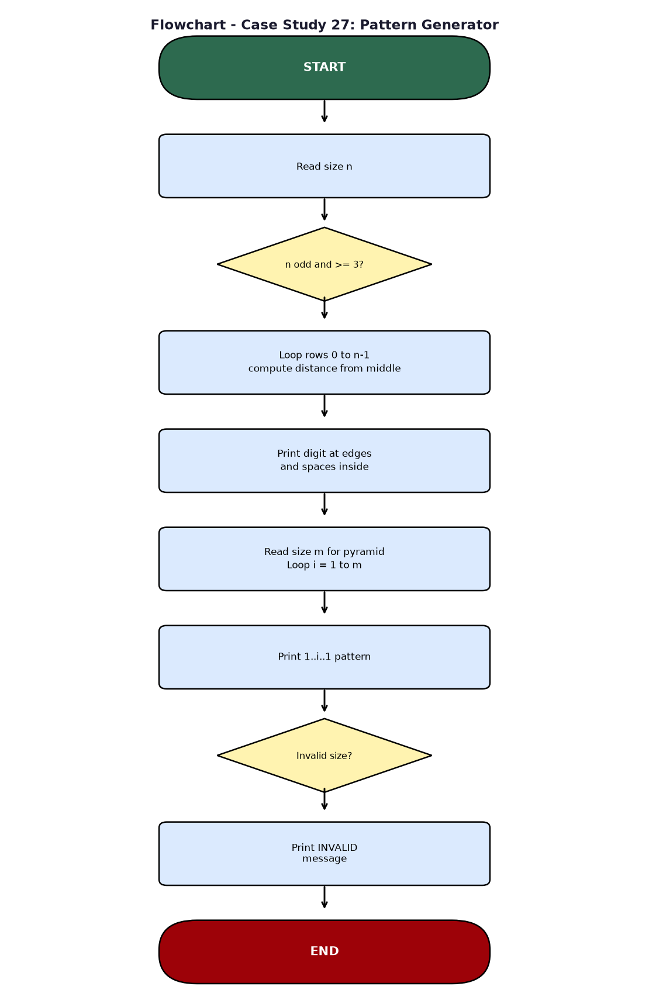
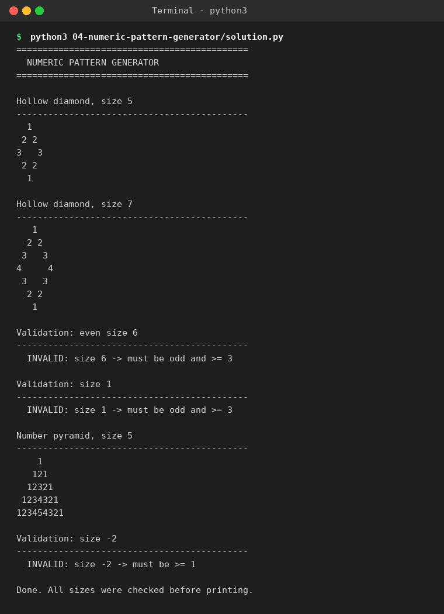

# Case Study 04 — Advanced Numeric Pattern Generator

**Name:** BOPPUDI KARTHIK  
**Roll No:** 26000451  
**Case Study No. in assignment:** 27

## Problem statement

Produce a hollow diamond and a symmetric numerical pyramid based on user-specified dimensions, with validation for invalid dimensions and carefully aligned output.

## Objectives

To generate patterns using nested loops, to validate dimensions with if-else checks, to align output using spaces and string concatenation, and to handle invalid sizes without crashing.

## Assumptions

Hollow diamond size n must be odd and at least 3. Number pyramid size m must be at least 1. The diamond prints the same digit at both edges of each row and spaces inside. The pyramid prints 1, 12, 123, ... and then decreases symmetrically (for example 1234321). Invalid sizes print an INVALID message and return False.

## Algorithm

```
1. START
2. For hollow diamond:
   - If n < 3 or n is even, print INVALID and return False
   - mid = n // 2
   - For i = 0 to n-1:
     - dist = abs(i - mid)
     - digit = mid - dist + 1
     - row_len = 2*(mid-dist)+1, pad = (n-row_len)//2
     - Build line: digit at first and last position, space in middle
     - Print pad spaces + line
3. For number pyramid:
   - If m < 1, print INVALID and return False
   - For i = 1 to m:
     - Build line 1..i then i-1..1
     - Print (m-i) spaces + line
4. Run demo sizes 5, 7 for diamond and 5 for pyramid, plus invalid sizes 6, 1, -2
5. END
```

## Flowchart



## Pseudocode

```
BEGIN PATTERN_GENERATOR
    FUNCTION hollow_diamond(n):
        IF n < 3 OR n MOD 2 = 0 THEN PRINT "INVALID" ; RETURN False
        mid <- n DIV 2
        FOR i <- 0 TO n-1 DO
            dist <- ABS(i - mid)
            digit <- mid - dist + 1
            row_len <- 2*(mid-dist)+1
            pad <- (n - row_len) DIV 2
            line <- ""
            FOR j <- 0 TO row_len-1 DO
                IF j = 0 OR j = row_len-1 THEN line <- line + digit
                ELSE line <- line + " "
            PRINT pad spaces + line
        RETURN True

    FUNCTION number_pyramid(m):
        IF m < 1 THEN PRINT "INVALID" ; RETURN False
        FOR i <- 1 TO m DO
            line <- ""
            FOR j <- 1 TO i DO line <- line + j
            FOR j <- i-1 DOWN TO 1 DO line <- line + j
            PRINT (m-i) spaces + line
        RETURN True
END
```

## Python source code

```python
# Case Study 27: Advanced Numeric Pattern Generator
# Name: BOPPUDI KARTHIK, Roll No: 26000451
# Uses: nested loops, if-else, operators, string handling, validation


def hollow_diamond(n):
    # n must be odd and >= 3
    if n < 3 or n % 2 == 0:
        print("  INVALID: size %d -> must be odd and >= 3" % n)
        return False

    mid = n // 2
    for i in range(n):
        dist = i - mid
        if dist < 0:
            dist = -dist
        digit = str(mid - dist + 1)
        row_len = 2 * (mid - dist) + 1
        pad = (n - row_len) // 2
        line = ""
        for j in range(row_len):
            if j == 0 or j == row_len - 1:
                line = line + digit
            else:
                line = line + " "
        print(" " * pad + line)
    return True


def number_pyramid(m):
    # m must be >= 1
    if m < 1:
        print("  INVALID: size %d -> must be >= 1" % m)
        return False
    for i in range(1, m + 1):
        line = ""
        for j in range(1, i + 1):
            line = line + str(j)
        for j in range(i - 1, 0, -1):
            line = line + str(j)
        print(" " * (m - i) + line)
    return True


def main():
    print("=" * 44)
    print("  NUMERIC PATTERN GENERATOR")
    print("=" * 44)

    print("\nHollow diamond, size 5")
    print("-" * 44)
    hollow_diamond(5)

    print("\nHollow diamond, size 7")
    print("-" * 44)
    hollow_diamond(7)

    print("\nValidation: even size 6")
    print("-" * 44)
    hollow_diamond(6)

    print("\nValidation: size 1")
    print("-" * 44)
    hollow_diamond(1)

    print("\nNumber pyramid, size 5")
    print("-" * 44)
    number_pyramid(5)

    print("\nValidation: size -2")
    print("-" * 44)
    number_pyramid(-2)

    print("\nDone. All sizes were checked before printing.")


if __name__ == "__main__":
    main()
```

## Test cases

10 test cases are written in test_cases.py. They check diamond size 5 accepted with 5 lines and middle line '3   3', even size 6 rejected, size 1 rejected, pyramid size 4 accepted with last line 1234321, size 0 and -3 rejected. All tests pass.

## Output screenshot



## Conclusion

Both patterns print correctly with proper alignment. Validation works for even sizes, too-small sizes and negative sizes. The hollow diamond shows spaces inside and digits only at the edges, as required. Only nested loops, if-else and string operations were used.
