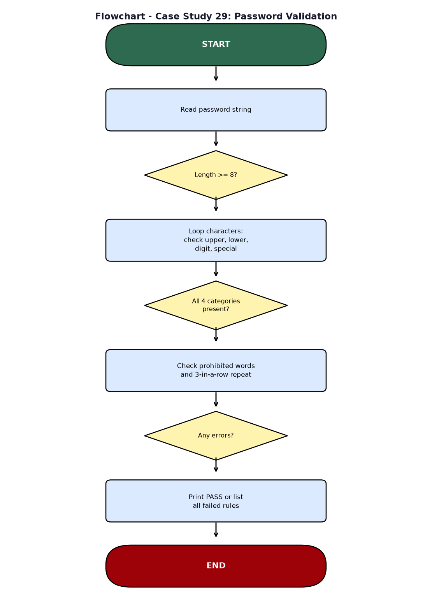
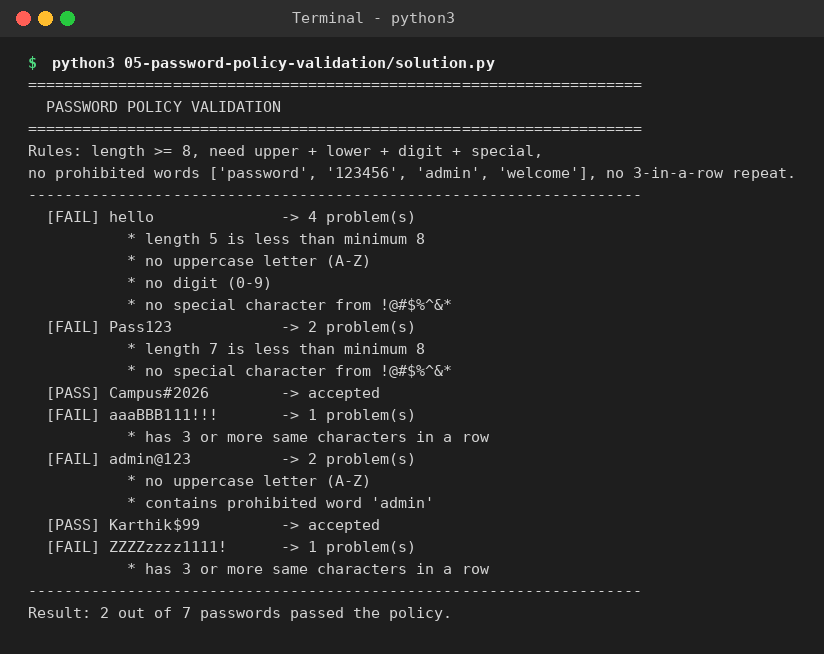

# Case Study 05 — Password Policy Validation Engine

**Name:** BOPPUDI KARTHIK  
**Roll No:** 26000451  
**Case Study No. in assignment:** 29

## Problem statement

Evaluate sample password strings against minimum length, character-category, repetition and prohibited-substring rules, and explain each failed condition.

## Objectives

To check password length, uppercase, lowercase, digit and special character presence using loops and if-else, to detect prohibited words using string search, to detect 3-in-a-row repeats, and to report every failed rule.

## Assumptions

Minimum length is 8. Password must contain at least one uppercase (A-Z), one lowercase (a-z), one digit (0-9) and one special character from !@#$%^&*. Prohibited words are password, 123456, admin and welcome (case-insensitive). Three or more same characters in a row is not allowed. Seven sample passwords are tested.

## Algorithm

```
1. START
2. Set MIN_LENGTH = 8, PROHIBITED list, SPECIALS string
3. For each sample password:
   - Create empty errors list
   - If len < 8, add length error
   - Loop over characters and set flags has_upper, has_lower, has_digit, has_special
   - If any flag is False, add corresponding error
   - Convert to lowercase and check each prohibited word with 'in'
   - Check repeat: loop and count consecutive same characters, if count >= 3 add error
   - If errors is empty, print PASS, else print FAIL with all errors
4. Print how many passwords passed
5. END
```

## Flowchart



## Pseudocode

```
BEGIN PASSWORD_VALIDATION
    MIN_LENGTH <- 8
    PROHIBITED <- ["password", "123456", "admin", "welcome"]
    SPECIALS <- "!@#$%^&*"

    FUNCTION has_repeat(pw):
        run <- 1
        FOR i <- 1 TO len(pw)-1 DO
            IF pw[i] = pw[i-1] THEN run <- run + 1
            ELSE run <- 1
            IF run >= 3 THEN RETURN True
        RETURN False

    FUNCTION validate(pw):
        errors <- []
        IF len(pw) < MIN_LENGTH THEN ADD "length" error
        has_upper <- False, has_lower <- False, has_digit <- False, has_special <- False
        FOR ch IN pw DO
            IF "A" <= ch <= "Z" THEN has_upper <- True
            ELSE IF "a" <= ch <= "z" THEN has_lower <- True
            ELSE IF "0" <= ch <= "9" THEN has_digit <- True
            ELSE IF ch IN SPECIALS THEN has_special <- True
        IF NOT has_upper THEN ADD error
        IF NOT has_lower THEN ADD error
        IF NOT has_digit THEN ADD error
        IF NOT has_special THEN ADD error
        FOR word IN PROHIBITED DO
            IF word IN lower(pw) THEN ADD error
        IF has_repeat(pw) THEN ADD error
        RETURN errors

    FOR pw IN samples DO
        errors <- validate(pw)
        IF errors empty THEN PRINT PASS ELSE PRINT FAIL + errors
END
```

## Python source code

```python
# Case Study 29: Password Policy Validation Engine
# Name: BOPPUDI KARTHIK, Roll No: 26000451
# Uses: strings, loops, if-else, operators, boolean checks

MIN_LENGTH = 8
PROHIBITED = ["password", "123456", "admin", "welcome"]
SPECIALS = "!@#$%^&*"


def has_repeat(pw):
    # check if same character comes 3 times in a row
    run = 1
    for i in range(1, len(pw)):
        if pw[i] == pw[i - 1]:
            run = run + 1
            if run >= 3:
                return True
        else:
            run = 1
    return False


def validate_password(pw):
    errors = []

    if len(pw) < MIN_LENGTH:
        errors.append("length %d is less than minimum %d" % (len(pw), MIN_LENGTH))

    has_upper = False
    has_lower = False
    has_digit = False
    has_special = False
    for ch in pw:
        if "A" <= ch <= "Z":
            has_upper = True
        elif "a" <= ch <= "z":
            has_lower = True
        elif "0" <= ch <= "9":
            has_digit = True
        elif ch in SPECIALS:
            has_special = True

    if has_upper == False:
        errors.append("no uppercase letter (A-Z)")
    if has_lower == False:
        errors.append("no lowercase letter (a-z)")
    if has_digit == False:
        errors.append("no digit (0-9)")
    if has_special == False:
        errors.append("no special character from %s" % SPECIALS)

    lower_pw = pw.lower()
    for word in PROHIBITED:
        if word in lower_pw:
            errors.append("contains prohibited word '%s'" % word)

    if has_repeat(pw):
        errors.append("has 3 or more same characters in a row")

    return errors


def main():
    samples = [
        "hello",
        "Pass123",
        "Campus#2026",
        "aaaBBB111!!!",
        "admin@123",
        "Karthik$99",
        "ZZZZzzzz1111!",
    ]

    print("=" * 68)
    print("  PASSWORD POLICY VALIDATION")
    print("=" * 68)
    print("Rules: length >= %d, need upper + lower + digit + special," % MIN_LENGTH)
    print("no prohibited words %s, no 3-in-a-row repeat." % PROHIBITED)
    print("-" * 68)

    passed = 0
    for pw in samples:
        errors = validate_password(pw)
        if len(errors) == 0:
            passed = passed + 1
            print("  [PASS] %-18s -> accepted" % pw)
        else:
            print("  [FAIL] %-18s -> %d problem(s)" % (pw, len(errors)))
            for e in errors:
                print("           * %s" % e)

    print("-" * 68)
    print("Result: %d out of %d passwords passed the policy." % (passed, len(samples)))


if __name__ == "__main__":
    main()
```

## Test cases

9 test cases are written in test_cases.py. They check Campus#2026 passes, short password fails length, missing uppercase, missing digit, missing special, prohibited word admin, repeat detection for aaa, no repeat in Campus#2026, and Karthik$99 passes. All tests pass.

## Output screenshot



## Conclusion

The validator correctly accepts strong passwords and rejects weak ones with clear reasons. In the sample, 2 out of 7 passwords passed. Each failed condition is explained separately, which makes the program useful for teaching password rules. Only strings, loops and if-else were used.
