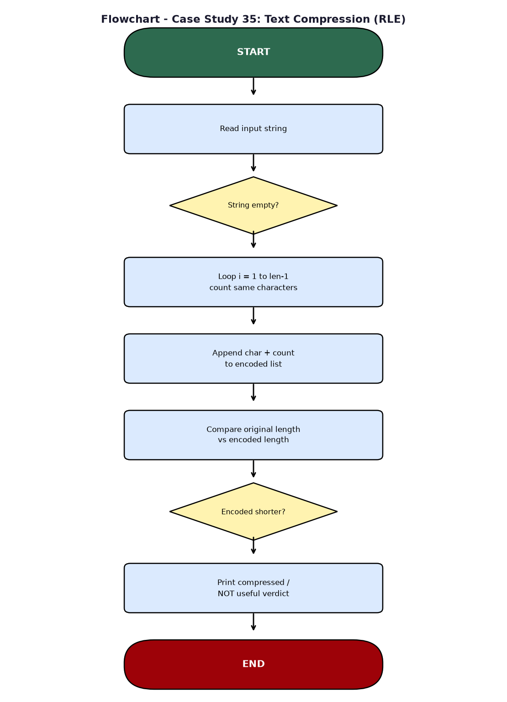
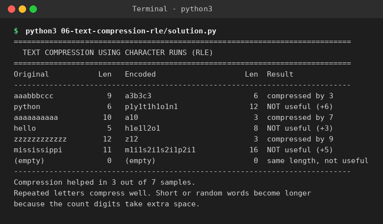

# Case Study 06 — Text Compression Using Character Runs

**Name:** BOPPUDI KARTHIK  
**Roll No:** 26000451  
**Case Study No. in assignment:** 35

## Problem statement

Encode a string by grouping consecutive repeated characters (run-length encoding) and compare original and encoded lengths, including cases where encoding is not beneficial.

## Objectives

To group consecutive same characters using a loop and counter, to build the encoded string in a list, to compare lengths with if-else, and to report whether compression helped or not.

## Assumptions

Input strings contain letters only, so the count part of the encoding is never confusing. Encoding format is character followed by count, for example aaabbb becomes a3b3. Empty string encodes to empty string. Seven sample strings are tested, including repetitive and non-repetitive cases.

## Algorithm

```
1. START
2. For each sample string s:
   - If s is empty, encoded = ""
   - Else set count = 1, parts = []
   - For i = 1 to len(s)-1:
     - If s[i] = s[i-1], count = count + 1
     - Else append s[i-1] + str(count) to parts, reset count = 1
   - Append last character + count to parts
   - Join parts to get encoded string
   - If len(encoded) < len(s), verdict = compressed
   - Else if len(encoded) > len(s), verdict = NOT useful
   - Else verdict = same length
   - Print original, lengths and verdict
3. Print how many samples benefited
4. END
```

## Flowchart



## Pseudocode

```
BEGIN RLE_COMPRESSION
    FUNCTION encode(text):
        IF text = "" THEN RETURN ""
        parts <- []
        count <- 1
        FOR i <- 1 TO len(text)-1 DO
            IF text[i] = text[i-1] THEN count <- count + 1
            ELSE
                APPEND text[i-1] + str(count) TO parts
                count <- 1
        APPEND text[-1] + str(count) TO parts
        RETURN join(parts)

    FOR s IN samples DO
        enc <- encode(s)
        IF len(enc) < len(s) THEN PRINT "compressed"
        ELSE IF len(enc) > len(s) THEN PRINT "NOT useful"
        ELSE PRINT "same length"
END
```

## Python source code

```python
# Case Study 35: Text Compression Using Character Runs (RLE)
# Name: BOPPUDI KARTHIK, Roll No: 26000451
# Uses: strings, loops, if-else, operators, lists
# Note: input strings have letters only, so count part is not confusing


def encode_text(text):
    if text == "":
        return ""
    parts = []
    count = 1
    for i in range(1, len(text)):
        if text[i] == text[i - 1]:
            count = count + 1
        else:
            parts.append(text[i - 1] + str(count))
            count = 1
    parts.append(text[-1] + str(count))
    result = ""
    for p in parts:
        result = result + p
    return result


def main():
    samples = [
        "aaabbbccc",
        "python",
        "aaaaaaaaaa",
        "hello",
        "zzzzzzzzzzzz",
        "mississippi",
        "",
    ]

    print("=" * 76)
    print("  TEXT COMPRESSION USING CHARACTER RUNS (RLE)")
    print("=" * 76)
    print("%-16s %5s   %-24s %5s  %s" % ("Original", "Len", "Encoded", "Len", "Result"))
    print("-" * 76)

    good = 0
    for s in samples:
        enc = encode_text(s)
        if len(enc) < len(s):
            verdict = "compressed by %d" % (len(s) - len(enc))
            good = good + 1
        elif len(enc) > len(s):
            verdict = "NOT useful (+%d)" % (len(enc) - len(s))
        else:
            verdict = "same length, not useful"
        shown_s = s
        if s == "":
            shown_s = "(empty)"
        shown_e = enc
        if enc == "":
            shown_e = "(empty)"
        print("%-16s %5d   %-24s %5d  %s" % (shown_s, len(s), shown_e, len(enc), verdict))

    print("-" * 76)
    print("Compression helped in %d out of %d samples." % (good, len(samples)))
    print("Repeated letters compress well. Short or random words become longer")
    print("because the count digits take extra space.")


if __name__ == "__main__":
    main()
```

## Test cases

8 test cases are written in test_cases.py. They check aaabbbccc becomes a3b3c3, python becomes p1y1t1h1o1n1, aaaaaaaaaa becomes a10, empty stays empty, single character a becomes a1, mississippi encoding, repetitive text compresses shorter, and python becomes longer. All tests pass.

## Output screenshot



## Conclusion

Run-length encoding works correctly. Repetitive strings like aaaaaaaaaa compress from 10 to 3 characters, while short words like python grow from 6 to 12 characters because counts add extra digits. In the sample, 3 out of 7 strings benefited. Only strings, loops and lists were used.
