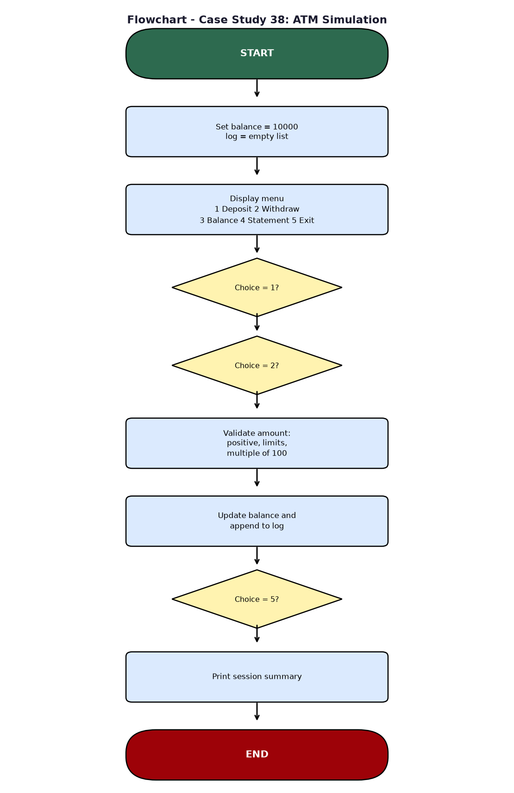
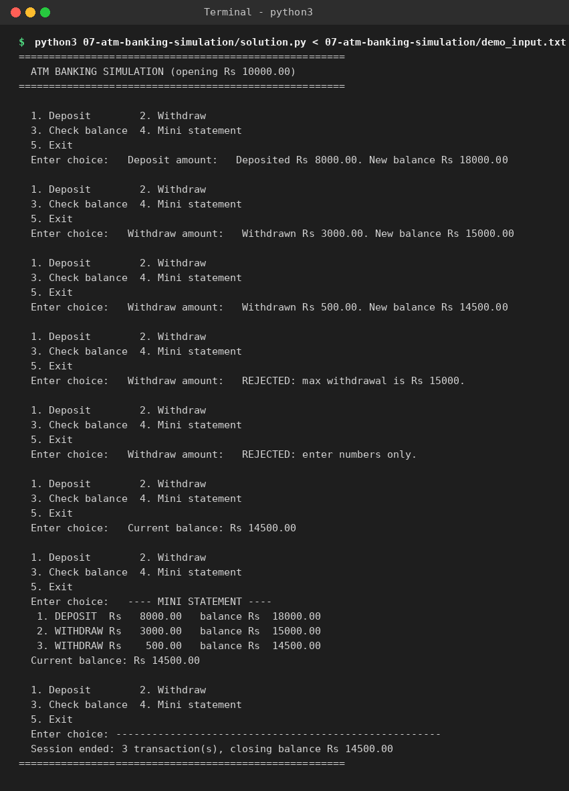

# Case Study 07 — ATM Menu-Driven Banking Simulation

**Name:** BOPPUDI KARTHIK  
**Roll No:** 26000451  
**Case Study No. in assignment:** 38

## Problem statement

Implement repeated menu operations for deposits, withdrawals, balance inquiries and transaction summaries, with validation and specified account limits.

## Objectives

To run a menu loop using while True and if-else, to validate every amount before changing balance, to store transactions as tuples in a list, to unpack tuples for the mini statement, and to handle non-numeric input without crashing.

## Assumptions

Opening balance is Rs 10,000. Deposits must be positive and at most Rs 50,000. Withdrawals must be positive multiples of Rs 100, at most Rs 15,000, and must leave at least Rs 2,000 in the account. There is a single account with no interest. Sample input is given in demo_input.txt and includes valid and invalid transactions.

## Algorithm

```
1. START
2. Set balance = 10000, log = []
3. LOOP forever:
   - Print menu: 1 Deposit, 2 Withdraw, 3 Balance, 4 Statement, 5 Exit
   - Read choice
   - If choice = 1: read amount (catch ValueError), call do_deposit
     - If amount <= 0 or > 50000, reject
     - Else balance += amount, append ("DEPOSIT", amount, balance) to log
   - If choice = 2: read amount (catch ValueError), call do_withdraw
     - If amount <= 0, reject
     - Else if amount % 100 != 0, reject
     - Else if amount > 15000, reject
     - Else if balance - amount < 2000, reject
     - Else balance -= amount, append ("WITHDRAW", amount, balance) to log
   - If choice = 3, print balance
   - If choice = 4, loop over log and unpack each tuple to print statement
   - If choice = 5, print session summary and break
   - Else print unknown option
4. END LOOP
5. END
```

## Flowchart



## Pseudocode

```
BEGIN ATM_SIMULATION
    balance <- 10000
    log <- []
    MIN_BALANCE <- 2000, MAX_WITHDRAW <- 15000, MAX_DEPOSIT <- 50000

    FUNCTION do_deposit(balance, log, amount):
        IF amount <= 0 OR amount > MAX_DEPOSIT THEN RETURN (balance, "REJECTED", False)
        new_balance <- balance + amount
        APPEND ("DEPOSIT", amount, new_balance) TO log
        RETURN (new_balance, "accepted", True)

    FUNCTION do_withdraw(balance, log, amount):
        IF amount <= 0 THEN RETURN (balance, "REJECTED", False)
        IF amount MOD 100 != 0 THEN RETURN (balance, "REJECTED", False)
        IF amount > MAX_WITHDRAW THEN RETURN (balance, "REJECTED", False)
        IF balance - amount < MIN_BALANCE THEN RETURN (balance, "REJECTED", False)
        new_balance <- balance - amount
        APPEND ("WITHDRAW", amount, new_balance) TO log
        RETURN (new_balance, "accepted", True)

    REPEAT
        PRINT menu
        READ choice
        IF choice = "1" THEN read amount, call do_deposit
        ELSE IF choice = "2" THEN read amount, call do_withdraw
        ELSE IF choice = "3" THEN PRINT balance
        ELSE IF choice = "4" THEN FOR (kind, amt, bal) IN log DO PRINT row
        ELSE IF choice = "5" THEN PRINT summary ; BREAK
        ELSE PRINT "unknown option"
    END REPEAT
END
```

## Python source code

```python
# Case Study 38: ATM Menu-Driven Banking Simulation
# Name: BOPPUDI KARTHIK, Roll No: 26000451
# Uses: loops (menu), if-else, operators, lists, tuples, unpacking

OPENING_BALANCE = 10000
MIN_BALANCE = 2000
MAX_WITHDRAW = 15000
MAX_DEPOSIT = 50000


def do_deposit(balance, log, amount):
    # returns (new_balance, message, ok)
    if amount <= 0:
        return balance, "REJECTED: deposit must be positive.", False
    if amount > MAX_DEPOSIT:
        return balance, "REJECTED: deposit exceeds Rs %d limit." % MAX_DEPOSIT, False
    new_balance = balance + amount
    log.append(("DEPOSIT", amount, new_balance))
    return new_balance, "Deposited Rs %.2f. New balance Rs %.2f" % (amount, new_balance), True


def do_withdraw(balance, log, amount):
    if amount <= 0:
        return balance, "REJECTED: withdrawal must be positive.", False
    if amount % 100 != 0:
        return balance, "REJECTED: withdrawal must be multiple of Rs 100.", False
    if amount > MAX_WITHDRAW:
        return balance, "REJECTED: max withdrawal is Rs %d." % MAX_WITHDRAW, False
    if balance - amount < MIN_BALANCE:
        return balance, "REJECTED: balance will go below minimum Rs %d (current Rs %.2f)." % (MIN_BALANCE, balance), False
    new_balance = balance - amount
    log.append(("WITHDRAW", amount, new_balance))
    return new_balance, "Withdrawn Rs %.2f. New balance Rs %.2f" % (amount, new_balance), True


def show_statement(log, balance):
    print("  ---- MINI STATEMENT ----")
    if len(log) == 0:
        print("  No transactions yet.")
    for i in range(len(log)):
        kind, amt, bal = log[i]
        print("  %2d. %-8s Rs %9.2f   balance Rs %9.2f" % (i + 1, kind, amt, bal))
    print("  Current balance: Rs %.2f" % balance)


def main():
    balance = OPENING_BALANCE
    log = []
    print("=" * 54)
    print("  ATM BANKING SIMULATION (opening Rs %.2f)" % OPENING_BALANCE)
    print("=" * 54)

    while True:
        print("\n  1. Deposit        2. Withdraw")
        print("  3. Check balance  4. Mini statement")
        print("  5. Exit")
        choice = input("  Enter choice: ").strip()

        if choice == "1":
            try:
                amount = float(input("  Deposit amount: ").strip())
                balance, msg, ok = do_deposit(balance, log, amount)
            except ValueError:
                msg = "REJECTED: enter numbers only."
            print("  " + msg)

        elif choice == "2":
            try:
                amount = float(input("  Withdraw amount: ").strip())
                balance, msg, ok = do_withdraw(balance, log, amount)
            except ValueError:
                msg = "REJECTED: enter numbers only."
            print("  " + msg)

        elif choice == "3":
            print("  Current balance: Rs %.2f" % balance)

        elif choice == "4":
            show_statement(log, balance)

        elif choice == "5":
            print("-" * 54)
            print("  Session ended: %d transaction(s), closing balance Rs %.2f" % (len(log), balance))
            print("=" * 54)
            break

        else:
            print("  REJECTED: unknown option '%s', choose 1-5." % choice)


if __name__ == "__main__":
    main()
```

## Test cases

10 test cases are written in test_cases.py. They check valid deposit, negative deposit rejected, deposit over limit, valid withdrawal, withdrawal not multiple of 100, withdrawal over max, withdrawal below minimum balance, withdrawal exactly to minimum allowed, non-numeric input caught, and log keeping running balance. All tests pass.

## Output screenshot



## Conclusion

The ATM simulation handles all menu options correctly and rejects invalid amounts with clear messages. The mini statement shows running balance after each transaction. In the demo, 3 transactions were accepted and closing balance was Rs 14,500. Only loops, if-else, lists, tuples and unpacking were used.
