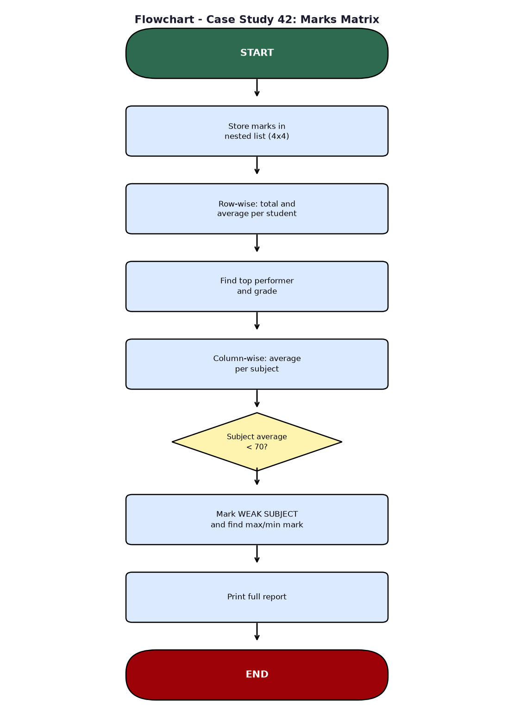
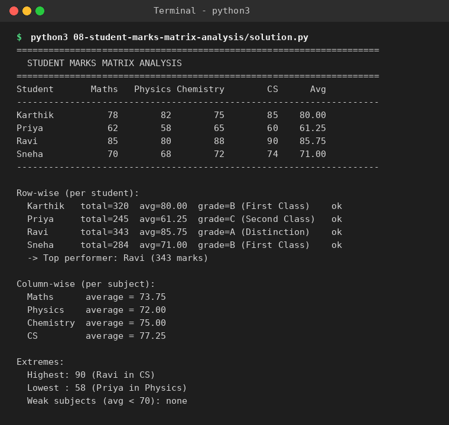

# Case Study 08 — Student Marks Matrix Analysis

**Name:** BOPPUDI KARTHIK  
**Roll No:** 26000451  
**Case Study No. in assignment:** 42

## Problem statement

Analyse a matrix of student marks across subjects, calculate row-wise and column-wise statistics, identify top performers, and detect subjects with low average performance.

## Objectives

To store marks in a nested list, to calculate row totals and averages using loops, to calculate column averages, to find highest and lowest marks with their positions, and to flag weak subjects and at-risk students.

## Assumptions

There are 4 students and 4 subjects (Maths, Physics, Chemistry, CS), so marks is a 4x4 nested list. Each mark is out of 100. Grade A is 85 or more, B is 70 or more, C is 55 or more, else D. A subject with average below 70 is weak. A student with average below 60 is at risk. All marks are sample data.

## Algorithm

```
1. START
2. Store STUDENTS, SUBJECTS and MARKS nested list
3. Print matrix with student names, subject marks and row average
4. Row-wise: for each student, total = sum of row, avg = total/4, grade from avg, status AT RISK if avg < 60
5. Track best_total and best_index to find top performer
6. Column-wise: for each subject, total = sum of column, avg = total/4, flag WEAK if avg < 70
7. Loop over all cells to find highest and lowest mark with row and column position
8. Print extremes and weak subject list
9. END
```

## Flowchart



## Pseudocode

```
BEGIN MARKS_MATRIX
    STUDENTS <- ["Karthik", "Priya", "Ravi", "Sneha"]
    SUBJECTS <- ["Maths", "Physics", "Chemistry", "CS"]
    MARKS <- [[78,82,75,85], [62,58,65,60], [85,80,88,90], [70,68,72,74]]

    PRINT matrix with row averages

    best_total <- -1
    FOR r <- 0 TO 3 DO
        total <- 0
        FOR m IN MARKS[r] DO total <- total + m
        avg <- total / 4
        grade <- grade_of(avg)
        IF total > best_total THEN best_total <- total, best_index <- r
    PRINT top performer

    FOR c <- 0 TO 3 DO
        total <- 0
        FOR r <- 0 TO 3 DO total <- total + MARKS[r][c]
        avg <- total / 4
        IF avg < 70 THEN PRINT "WEAK SUBJECT"

    FIND max and min by looping over all r, c
    PRINT extremes
END
```

## Python source code

```python
# Case Study 42: Student Marks Matrix Analysis
# Name: BOPPUDI KARTHIK, Roll No: 26000451
# Uses: nested lists, loops, if-else, operators, row/column statistics

SUBJECTS = ["Maths", "Physics", "Chemistry", "CS"]
STUDENTS = ["Karthik", "Priya", "Ravi", "Sneha"]

# rows = students, columns = subjects
MARKS = [
    [78, 82, 75, 85],
    [62, 58, 65, 60],
    [85, 80, 88, 90],
    [70, 68, 72, 74],
]

WEAK_AVG = 70.0
RISK_AVG = 60.0


def grade_of(avg):
    if avg >= 85:
        return "A (Distinction)"
    if avg >= 70:
        return "B (First Class)"
    if avg >= 55:
        return "C (Second Class)"
    return "D (Third Class)"


def main():
    print("=" * 68)
    print("  STUDENT MARKS MATRIX ANALYSIS")
    print("=" * 68)
    header = "%-9s" % "Student" + "".join("%10s" % s for s in SUBJECTS) + "%9s" % "Avg"
    print(header)
    print("-" * 68)
    for r in range(len(STUDENTS)):
        row = MARKS[r]
        total = 0
        for m in row:
            total = total + m
        avg = total / len(row)
        print("%-9s" % STUDENTS[r] + "".join("%10d" % m for m in row) + "%9.2f" % avg)
    print("-" * 68)

    print("\nRow-wise (per student):")
    best_total = -1
    best_index = -1
    for r in range(len(STUDENTS)):
        total = 0
        for m in MARKS[r]:
            total = total + m
        avg = total / len(MARKS[r])
        status = "AT RISK" if avg < RISK_AVG else "ok"
        print("  %-9s total=%3d  avg=%5.2f  grade=%-18s %s" % (STUDENTS[r], total, avg, grade_of(avg), status))
        if total > best_total:
            best_total = total
            best_index = r
    print("  -> Top performer: %s (%d marks)" % (STUDENTS[best_index], best_total))

    print("\nColumn-wise (per subject):")
    weak_list = []
    for c in range(len(SUBJECTS)):
        total = 0
        for r in range(len(STUDENTS)):
            total = total + MARKS[r][c]
        avg = total / len(STUDENTS)
        flag = ""
        if avg < WEAK_AVG:
            flag = "  << WEAK SUBJECT"
            weak_list.append(SUBJECTS[c])
        print("  %-10s average = %5.2f%s" % (SUBJECTS[c], avg, flag))

    # find highest and lowest mark with position
    high = -1
    low = 101
    hi_r = 0
    hi_c = 0
    lo_r = 0
    lo_c = 0
    for r in range(len(STUDENTS)):
        for c in range(len(SUBJECTS)):
            if MARKS[r][c] > high:
                high = MARKS[r][c]
                hi_r = r
                hi_c = c
            if MARKS[r][c] < low:
                low = MARKS[r][c]
                lo_r = r
                lo_c = c
    print("\nExtremes:")
    print("  Highest: %d (%s in %s)" % (high, STUDENTS[hi_r], SUBJECTS[hi_c]))
    print("  Lowest : %d (%s in %s)" % (low, STUDENTS[lo_r], SUBJECTS[lo_c]))
    if len(weak_list) == 0:
        print("  Weak subjects (avg < %.0f): none" % WEAK_AVG)
    else:
        joined = ""
        for i in range(len(weak_list)):
            if i > 0:
                joined = joined + ", "
            joined = joined + weak_list[i]
        print("  Weak subjects (avg < %.0f): %s" % (WEAK_AVG, joined))


if __name__ == "__main__":
    main()
```

## Test cases

13 test cases are written in test_cases.py. They check matrix size 4x4, Karthik total 320, Ravi total 343, grades A/B/C/D, Maths average 73.75, highest mark 90, lowest mark 58. All tests pass.

## Output screenshot



## Conclusion

Row-wise and column-wise statistics are correct. Ravi is the top performer with 343 marks and average 85.75 (grade A). No subject is weak in this sample because all subject averages are above 70. Highest mark is 90 (Ravi in CS) and lowest is 58 (Priya in Physics). Only nested lists, loops and if-else were used.
