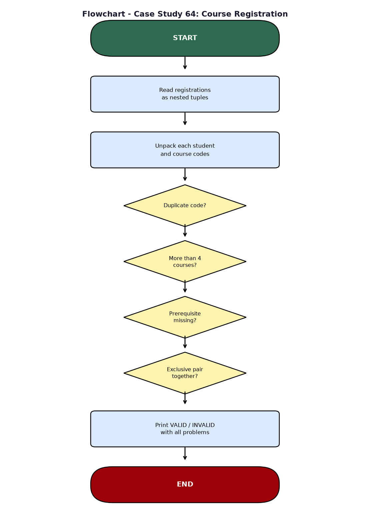
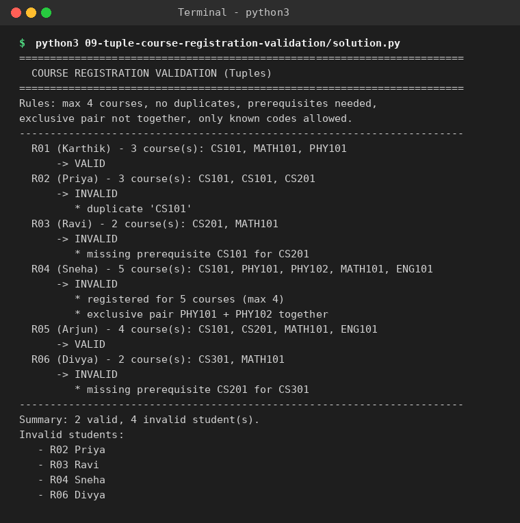

# Case Study 09 — Tuple-Based Course Registration Validation

**Name:** BOPPUDI KARTHIK  
**Roll No:** 26000451  
**Case Study No. in assignment:** 64

## Problem statement

Represent course registrations as tuples, identify duplicate registrations and invalid course combinations, and determine students whose selections violate supplied rules.

## Objectives

To store registrations as nested tuples, to unpack tuples in loops, to check five rules (duplicates, max courses, prerequisites, exclusive pairs, unknown codes) using if-else, and to report every violation for each student.

## Assumptions

Maximum 4 courses per student. Prerequisites: CS201 needs CS101, CS301 needs CS201. PHY101 and PHY102 cannot be taken together. Known codes are CS101, CS201, CS301, MATH101, PHY101, PHY102, ENG101. Each registration is (roll, name, ((code, title), ...)). Six sample students are tested.

## Algorithm

```
1. START
2. Define MAX_COURSES = 4, PREREQ list, EXCLUSIVE list, KNOWN list, REGISTRATIONS nested tuples
3. For each student:
   - Unpack roll, name, courses
   - Build codes list by unpacking each (code, title)
   - Create empty problems list
   - For each code, if codes.count(code) > 1, add duplicate problem
   - If len(courses) > 4, add max-courses problem
   - For each code, find its prerequisite; if prerequisite not in codes, add problem
   - For each exclusive pair, if both codes present, add problem
   - For each code, if code not in KNOWN, add unknown-code problem
   - Print VALID if problems empty, else INVALID with all problems
4. Print summary counts and invalid student list
5. END
```

## Flowchart



## Pseudocode

```
BEGIN COURSE_VALIDATION
    MAX_COURSES <- 4
    PREREQ <- [("CS201","CS101"), ("CS301","CS201")]
    EXCLUSIVE <- [("PHY101","PHY102")]
    KNOWN <- ["CS101","CS201","CS301","MATH101","PHY101","PHY102","ENG101"]

    FUNCTION validate(student):
        (roll, name, courses) <- student
        codes <- []
        FOR (code, title) IN courses DO APPEND code TO codes
        problems <- []
        FOR c IN codes DO
            IF count(c) > 1 THEN ADD "duplicate" problem
        IF len(courses) > MAX_COURSES THEN ADD "too many" problem
        FOR c IN codes DO
            need <- find_prereq(c)
            IF need exists AND need NOT IN codes THEN ADD "missing prerequisite"
        FOR (a,b) IN EXCLUSIVE DO
            IF a IN codes AND b IN codes THEN ADD "exclusive pair"
        FOR c IN codes DO
            IF c NOT IN KNOWN THEN ADD "unknown code"
        RETURN problems

    FOR student IN REGISTRATIONS DO
        problems <- validate(student)
        IF problems empty THEN PRINT "VALID" ELSE PRINT "INVALID" + problems
END
```

## Python source code

```python
# Case Study 64: Tuple-Based Course Registration Validation
# Name: BOPPUDI KARTHIK, Roll No: 26000451
# Uses: tuples, nested tuples, unpacking, lists, loops, if-else

MAX_COURSES = 4
# prerequisite: course -> needed course
PREREQ = [("CS201", "CS101"), ("CS301", "CS201")]
# these two cannot be taken together
EXCLUSIVE = [("PHY101", "PHY102")]
KNOWN = ["CS101", "CS201", "CS301", "MATH101", "PHY101", "PHY102", "ENG101"]

# each record: (roll, name, ((code, title), ...))
REGISTRATIONS = [
    ("R01", "Karthik", (
        ("CS101", "Intro Programming"),
        ("MATH101", "Calculus"),
        ("PHY101", "Physics I"),
    )),
    ("R02", "Priya", (
        ("CS101", "Intro Programming"),
        ("CS101", "Intro Programming"),
        ("CS201", "Data Structures"),
    )),
    ("R03", "Ravi", (
        ("CS201", "Data Structures"),
        ("MATH101", "Calculus"),
    )),
    ("R04", "Sneha", (
        ("CS101", "Intro Programming"),
        ("PHY101", "Physics I"),
        ("PHY102", "Physics II"),
        ("MATH101", "Calculus"),
        ("ENG101", "Technical English"),
    )),
    ("R05", "Arjun", (
        ("CS101", "Intro Programming"),
        ("CS201", "Data Structures"),
        ("MATH101", "Calculus"),
        ("ENG101", "Technical English"),
    )),
    ("R06", "Divya", (
        ("CS301", "Algorithms"),
        ("MATH101", "Calculus"),
    )),
]


def find_prereq(course):
    for c, need in PREREQ:
        if c == course:
            return need
    return None


def validate(student):
    roll, name, courses = student
    codes = []
    for code, title in courses:
        codes.append(code)

    problems = []

    # duplicate check
    for c in codes:
        if codes.count(c) > 1:
            msg = "duplicate '%s'" % c
            if msg not in problems:
                problems.append(msg)

    # too many courses
    if len(courses) > MAX_COURSES:
        problems.append("registered for %d courses (max %d)" % (len(courses), MAX_COURSES))

    # prerequisite check
    for c in codes:
        need = find_prereq(c)
        if need != None and need not in codes:
            msg = "missing prerequisite %s for %s" % (need, c)
            if msg not in problems:
                problems.append(msg)

    # exclusive pair check
    for a, b in EXCLUSIVE:
        if a in codes and b in codes:
            problems.append("exclusive pair %s + %s together" % (a, b))

    # unknown code check
    for c in codes:
        if c not in KNOWN:
            problems.append("unknown course code '%s'" % c)

    return problems


def main():
    print("=" * 72)
    print("  COURSE REGISTRATION VALIDATION (Tuples)")
    print("=" * 72)
    print("Rules: max %d courses, no duplicates, prerequisites needed," % MAX_COURSES)
    print("exclusive pair not together, only known codes allowed.")
    print("-" * 72)

    invalid_count = 0
    for student in REGISTRATIONS:
        roll, name, courses = student
        codes = []
        for code, title in courses:
            codes.append(code)
        problems = validate(student)
        if len(problems) == 0:
            status = "VALID"
        else:
            status = "INVALID"
            invalid_count = invalid_count + 1
        joined = ""
        for i in range(len(codes)):
            if i > 0:
                joined = joined + ", "
            joined = joined + codes[i]
        print("  %s (%s) - %d course(s): %s" % (roll, name, len(courses), joined))
        print("      -> %s" % status)
        for p in problems:
            print("         * %s" % p)

    print("-" * 72)
    valid_count = len(REGISTRATIONS) - invalid_count
    print("Summary: %d valid, %d invalid student(s)." % (valid_count, invalid_count))
    print("Invalid students:")
    for student in REGISTRATIONS:
        if len(validate(student)) > 0:
            roll, name, courses = student
            print("   - %s %s" % (roll, name))


if __name__ == "__main__":
    main()
```

## Test cases

9 test cases are written in test_cases.py. They check Karthik valid, Priya duplicate CS101, Ravi missing prerequisite, Sneha too many courses and exclusive pair, Arjun valid, Divya missing CS201, unknown code detection, and counts 2 valid / 4 invalid. All tests pass.

## Output screenshot



## Conclusion

All five rules are checked correctly for every student. Only Karthik and Arjun are valid; the other four have clear violations. Tuple unpacking makes the code clean because each course is stored as a (code, title) pair. Only tuples, lists, loops and if-else were used.
