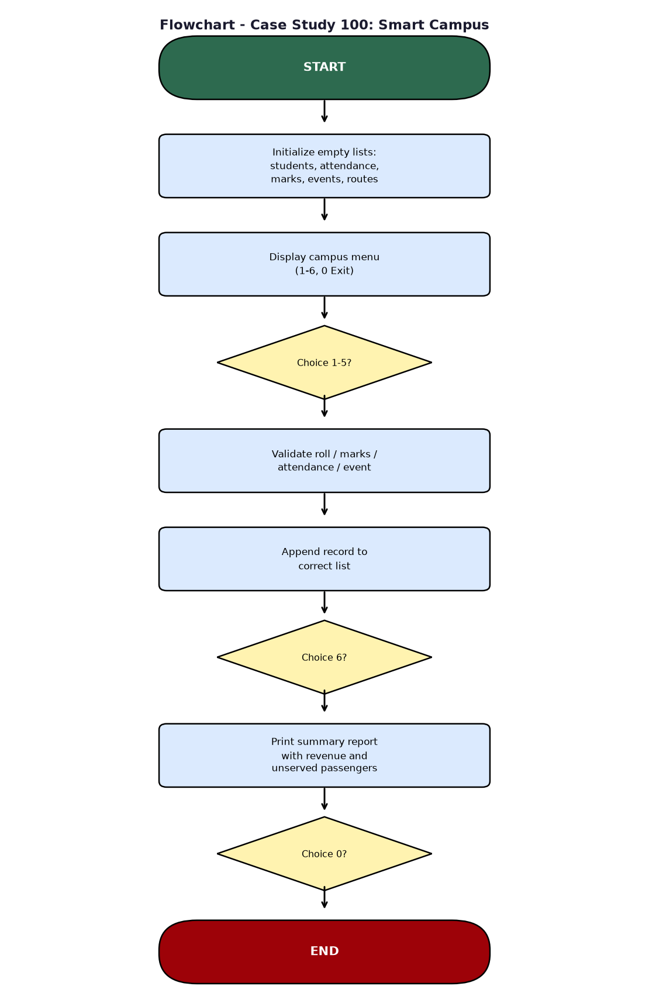
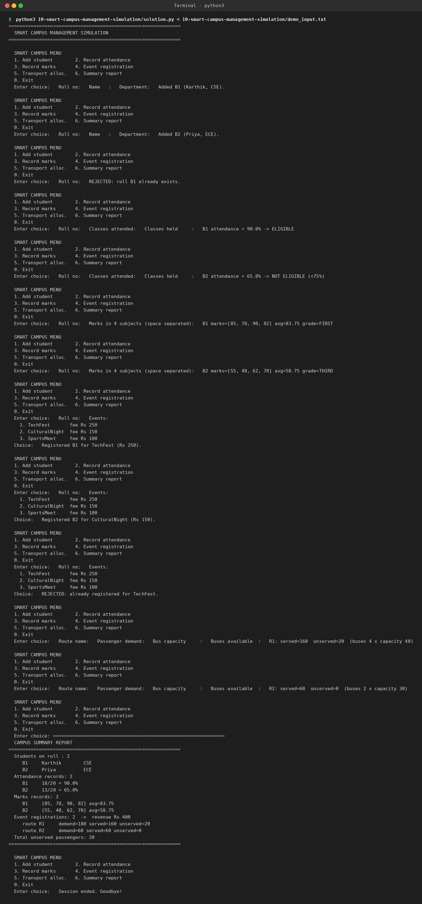

# Case Study 10 — Comprehensive Smart Campus Management Simulation

**Name:** BOPPUDI KARTHIK  
**Roll No:** 26000451  
**Case Study No. in assignment:** 100

## Problem statement

Develop a menu-driven program that integrates student records, attendance, marks, event registration, resource allocation and summary reporting using conditional statements, loops, strings, lists, nested lists, tuples and tuple unpacking.

## Objectives

To build a menu loop with 6 operations, to validate roll numbers, marks and attendance before storing, to store all records as tuples in lists, to prevent duplicate students and duplicate event registrations, to calculate transport served and unserved passengers, and to print a full summary report.

## Assumptions

Students are stored as (roll, name, dept). Attendance is (roll, present, total) and must satisfy 0 <= present <= total. Marks are 4 subjects, each 0-100, and grade is FIRST (75+), SECOND (60+), THIRD (40+), else FAIL. Events are TechFest Rs 250, CulturalNight Rs 150, SportsMeet Rs 100. Transport served = buses x capacity capped at demand. Sample input is in demo_input.txt.

## Algorithm

```
1. START
2. Initialize empty lists: students, attendance, marks_records, event_regs, route_stats
3. LOOP forever:
   - Print menu 1 Add student, 2 Attendance, 3 Marks, 4 Event, 5 Transport, 6 Summary, 0 Exit
   - Read choice
   - Choice 1: read roll; if empty or duplicate, reject; else read name and dept, append tuple
   - Choice 2: read roll; if unknown, reject; read present and total; if invalid, reject; else append and print % with ELIGIBLE if >= 75
   - Choice 3: read roll; if unknown, reject; read 4 marks; if not 4 numbers or out of 0-100, reject; else append, calculate avg and grade
   - Choice 4: read roll; if unknown, reject; show events, read choice; if invalid or already registered, reject; else append (roll, event, fee)
   - Choice 5: read route, demand, capacity, buses; if invalid, reject; else calculate served and unserved, append stats
   - Choice 6: print summary with all lists, revenue and total unserved
   - Choice 0: print goodbye and break
   - Else print unknown option
4. END LOOP
5. END
```

## Flowchart



## Pseudocode

```
BEGIN SMART_CAMPUS
    students <- [], attendance <- [], marks_records <- [], event_regs <- [], route_stats <- []
    EVENTS <- [("TechFest",250), ("CulturalNight",150), ("SportsMeet",100)]

    FUNCTION find_student(roll):
        FOR s IN students DO IF s[0] = roll THEN RETURN s
        RETURN None

    REPEAT
        PRINT menu
        READ choice
        IF choice = "1" THEN
            READ roll; IF empty OR duplicate THEN reject ELSE READ name, dept; APPEND (roll,name,dept)
        ELSE IF choice = "2" THEN
            READ roll; IF unknown THEN reject
            READ present, total; IF invalid THEN reject
            APPEND (roll,present,total); PRINT % and ELIGIBLE/NOT ELIGIBLE
        ELSE IF choice = "3" THEN
            READ roll; IF unknown THEN reject
            READ 4 marks; IF invalid THEN reject
            APPEND (roll,marks); PRINT avg and grade
        ELSE IF choice = "4" THEN
            READ roll; IF unknown THEN reject
            PRINT events; READ choice; IF invalid OR duplicate THEN reject
            APPEND (roll,event,fee)
        ELSE IF choice = "5" THEN
            READ route, demand, capacity, buses; IF invalid THEN reject
            served <- min(demand, buses*capacity); unserved <- demand - served
            APPEND stats; PRINT served/unserved
        ELSE IF choice = "6" THEN PRINT summary report
        ELSE IF choice = "0" THEN BREAK
        ELSE PRINT "unknown option"
    END REPEAT
END
```

## Python source code

```python
# Case Study 100: Comprehensive Smart Campus Management Simulation
# Name: BOPPUDI KARTHIK, Roll No: 26000451
# Uses: menu loop, if-else, strings, lists, tuples, unpacking, operators

students = []        # (roll, name, dept)
attendance = []      # (roll, present, total)
marks_records = []   # (roll, [m1, m2, m3, m4])
event_regs = []      # (roll, event_name, fee)
route_stats = []     # (route, demand, capacity, buses)

EVENTS = [("TechFest", 250), ("CulturalNight", 150), ("SportsMeet", 100)]


def find_student(roll):
    for s in students:
        if s[0] == roll:
            return s
    return None


def add_student():
    roll = input("  Roll no: ").strip().upper()
    if roll == "":
        print("  REJECTED: roll is required.")
        return
    if find_student(roll) != None:
        print("  REJECTED: roll %s already exists." % roll)
        return
    name = input("  Name   : ").strip()
    if name == "":
        print("  REJECTED: name is required.")
        return
    dept = input("  Department: ").strip().upper()
    students.append((roll, name, dept))
    print("  Added %s (%s, %s)." % (roll, name, dept))


def record_attendance():
    roll = input("  Roll no: ").strip().upper()
    if find_student(roll) == None:
        print("  REJECTED: unknown roll %s." % roll)
        return
    try:
        present = int(input("  Classes attended: ").strip())
        total = int(input("  Classes held     : ").strip())
    except ValueError:
        print("  REJECTED: enter numbers only.")
        return
    if total <= 0 or present < 0 or present > total:
        print("  REJECTED: invalid attendance values.")
        return
    attendance.append((roll, present, total))
    pct = present * 100.0 / total
    if pct >= 75:
        verdict = "ELIGIBLE"
    else:
        verdict = "NOT ELIGIBLE (<75%)"
    print("  %s attendance = %.1f%% -> %s" % (roll, pct, verdict))


def record_marks():
    roll = input("  Roll no: ").strip().upper()
    if find_student(roll) == None:
        print("  REJECTED: unknown roll %s." % roll)
        return
    raw = input("  Marks in 4 subjects (space separated): ").strip().split()
    if len(raw) != 4:
        print("  REJECTED: exactly 4 marks needed.")
        return
    try:
        marks = []
        for x in raw:
            marks.append(int(x))
    except ValueError:
        print("  REJECTED: marks must be integers.")
        return
    for m in marks:
        if m < 0 or m > 100:
            print("  REJECTED: marks must be within 0-100.")
            return
    marks_records.append((roll, marks))
    total = 0
    for m in marks:
        total = total + m
    avg = total / len(marks)
    if avg >= 75:
        grade = "FIRST"
    elif avg >= 60:
        grade = "SECOND"
    elif avg >= 40:
        grade = "THIRD"
    else:
        grade = "FAIL"
    print("  %s marks=%s avg=%.2f grade=%s" % (roll, marks, avg, grade))


def register_event():
    roll = input("  Roll no: ").strip().upper()
    if find_student(roll) == None:
        print("  REJECTED: unknown roll %s." % roll)
        return
    print("  Events:")
    for i in range(len(EVENTS)):
        print("    %d. %-14s fee Rs %d" % (i + 1, EVENTS[i][0], EVENTS[i][1]))
    try:
        choice = int(input("  Choice: ").strip())
    except ValueError:
        print("  REJECTED: invalid choice.")
        return
    if choice < 1 or choice > len(EVENTS):
        print("  REJECTED: choice out of range.")
        return
    event_name, fee = EVENTS[choice - 1]
    for r, ev, f in event_regs:
        if r == roll and ev == event_name:
            print("  REJECTED: already registered for %s." % event_name)
            return
    event_regs.append((roll, event_name, fee))
    print("  Registered %s for %s (Rs %d)." % (roll, event_name, fee))


def allocate_transport():
    route = input("  Route name: ").strip()
    try:
        demand = int(input("  Passenger demand: ").strip())
        capacity = int(input("  Bus capacity     : ").strip())
        buses = int(input("  Buses available  : ").strip())
    except ValueError:
        print("  REJECTED: enter numbers only.")
        return
    if demand < 0 or capacity <= 0 or buses < 0:
        print("  REJECTED: invalid transport values.")
        return
    served = buses * capacity
    if served > demand:
        served = demand
    unserved = demand - served
    route_stats.append((route, demand, capacity, buses))
    print("  %s: served=%d  unserved=%d  (buses %d x capacity %d)" % (route, served, unserved, buses, capacity))


def summary():
    print("=" * 62)
    print("  CAMPUS SUMMARY REPORT")
    print("=" * 62)
    print("  Students on roll : %d" % len(students))
    for roll, name, dept in students:
        print("     %-6s %-14s %s" % (roll, name, dept))
    print("  Attendance records: %d" % len(attendance))
    for roll, present, total in attendance:
        pct = present * 100.0 / total
        print("     %-6s %d/%d = %.1f%%" % (roll, present, total, pct))
    print("  Marks records: %d" % len(marks_records))
    for roll, marks in marks_records:
        total = 0
        for m in marks:
            total = total + m
        avg = total / len(marks)
        print("     %-6s %s avg=%.2f" % (roll, marks, avg))
    revenue = 0
    for roll, ev, fee in event_regs:
        revenue = revenue + fee
    print("  Event registrations: %d  ->  revenue Rs %d" % (len(event_regs), revenue))
    total_unserved = 0
    for route, demand, capacity, buses in route_stats:
        served = buses * capacity
        if served > demand:
            served = demand
        unserved = demand - served
        total_unserved = total_unserved + unserved
        print("     route %-6s demand=%d served=%d unserved=%d" % (route, demand, served, unserved))
    print("  Total unserved passengers: %d" % total_unserved)
    print("=" * 62)


def main():
    print("=" * 62)
    print("  SMART CAMPUS MANAGEMENT SIMULATION")
    print("=" * 62)
    while True:
        print("\n  SMART CAMPUS MENU")
        print("  1. Add student        2. Record attendance")
        print("  3. Record marks       4. Event registration")
        print("  5. Transport alloc.   6. Summary report")
        print("  0. Exit")
        choice = input("  Enter choice: ").strip()

        if choice == "1":
            add_student()
        elif choice == "2":
            record_attendance()
        elif choice == "3":
            record_marks()
        elif choice == "4":
            register_event()
        elif choice == "5":
            allocate_transport()
        elif choice == "6":
            summary()
        elif choice == "0":
            print("  Session ended. Goodbye!")
            break
        else:
            print("  REJECTED: unknown option '%s'." % choice)


if __name__ == "__main__":
    main()
```

## Test cases

16 test cases are written in test_cases.py. They check adding a student, duplicate and empty roll rejected, attendance 90% eligible and 65% not eligible, present greater than total rejected, marks avg 83.75 FIRST, mark over 100 rejected, TechFest registration Rs 250, duplicate event rejected, transport unserved 20, summary reporting, and find_student lookup. All tests pass.

## Output screenshot



## Conclusion

The smart campus program integrates all syllabus topics in one menu-driven system. Validation prevents duplicate rolls, invalid marks and duplicate event registrations. The summary correctly reports 2 students, revenue Rs 400 from 2 events in the demo, and 20 unserved passengers on route R1. Only syllabus topics were used, with no extra packages.
